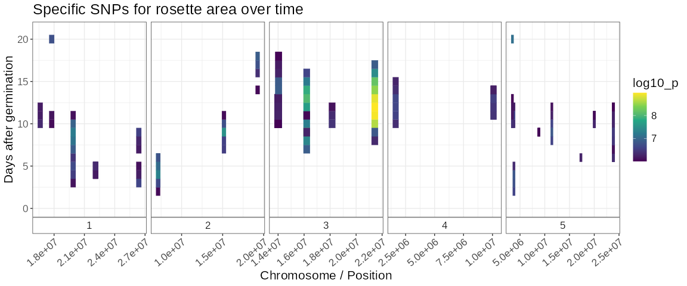
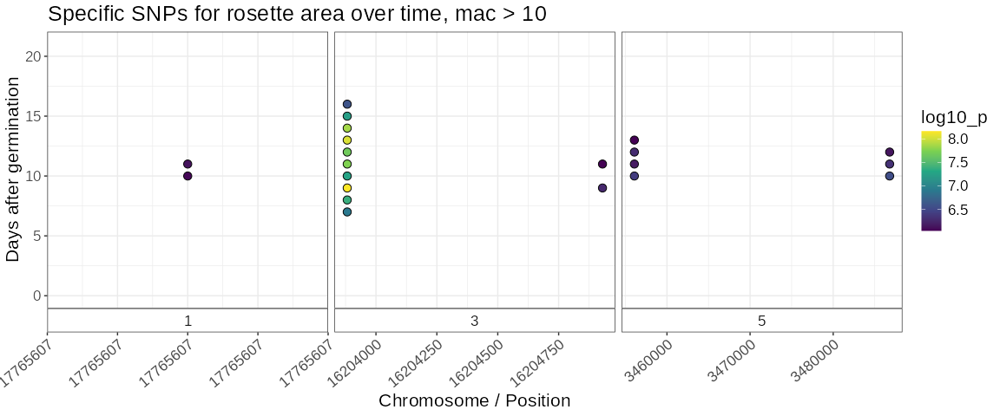

00 ARADEEPOPSIS analysis
================
Niklas Schandry

# Dataset

All files required to run this script can be found in `Inputs`.

The plant_region_area output from
[`aradeepopsis`](https://github.com/Gregor-Mendel-Institute/aradeepopsis)
has been joined to a table containing image metadata and saved to
`aradeepopsis.plant_region_area.metadata.csv.gz`.
[`aradeepopsis`](https://github.com/Gregor-Mendel-Institute/aradeepopsis)
was run in `multitrait` mode.

Metadata can be found in `metadata_2018.csv` and `metadata_2020.csv`,
joining was done based on `Snapshot_ID_Tag` (2018 metadata) or
`plant_id`(2020 metadata), extracted from the image filename. Images are
available at `<PLACEHOLDER>`.

# Analysis

The table containing `plant_region_area` values is in `Inputs`

``` r
bx_soil_areas <- read_csv("Inputs/aradeepopsis.plant_region_area.metadata.csv.gz")
```

    ## Rows: 220413 Columns: 14
    ## ── Column specification ────────────────────────────────────────────────────────
    ## Delimiter: ","
    ## chr  (6): month, day, hour, minute, genotype, bx
    ## dbl  (4): year, dag, genotype_id, plant_region_area
    ## lgl  (1): removed
    ## dttm (1): Date
    ## date (2): Date_day, germination_date
    ## 
    ## ℹ Use `spec()` to retrieve the full column specification for this data.
    ## ℹ Specify the column types or set `show_col_types = FALSE` to quiet this message.

The table contains the `plant_region_area` column from `aradeepopsis`,
and several columns that are metadata.

Metadata columns are:

- `Date`, `year`, `month`, `day`, `hour`, `minute`: Image timestamp

- `removed`: logical column whether the individual images was still in
  the chamber, used to remove images where the pot was removed (plant
  flowered). This variable is based on detecting a drop in plant size
  that occurred after 10dag. The ratio of plant size relative to plant
  size at the previous time-point was calculated for each individual and
  time-point. We considered spontaneous shrinkage of plants by 75%
  unlikely. If the ratio was less that 0.25, and dag was greater than
  10, the individual was therefore assumed to have been removed and this
  and all subsequent observations were flagged as `removed = TRUE`.

- `Date_day`: Days since the start of the experiment

- `germination_date`: date where green pixels were identified for the
  first time since the start of the experiment, used to compute dag

- `dag`: days since germination, difference between `Date` and
  `germination_date`

- `genotype`: Name of the accession

- `genotype_id`: numeric ID of the accession (compare 1001genomes.org)

- `bx`: column indicating the soil bx status.

# GWAS

The plant_region_area measurements were transformed into a wide table
containing one `plant_region_area` column per dag containing the mean
pixel value for each genotype per soil type. This was then exported into
two `.csv` files, one for BX<sub>Plus</sub> and one for
BX<sub>Minus</sub>

``` r
total_for_pivot <- bx_soil_areas %>% 
  filter(removed == F) %>% 
  mutate(dag = round(dag,0)) %>% 
  filter(dag < 61) %>% 
  dplyr::select(-c("genotype",
                   "hour", 
                   "minute", 
                   "year", 
                   "month",
                   "day",
                   "removed",
                   "germination_date",
                   "Date",
                   "Date_day")) 

total_for_pivot %<>% as.data.frame() 
  
total_for_pivot[is.na(total_for_pivot)] <- NA # also replaces NaN

total_for_pivot <- total_for_pivot %>%
                    mutate(genotype_id = as.factor(genotype_id),
                           bx = as.factor(bx))

fn_list <- colnames(total_for_pivot[,3:ncol(total_for_pivot)]) %>% 
  {as.list(rep("mean",length(.)))} 

names(fn_list) <- colnames(total_for_pivot[,3:ncol(total_for_pivot)])

formals(mean.default)$na.rm <- TRUE # let mean remove NA inside of pivot_wider

total_wide <- total_for_pivot %>% 
  pivot_wider(names_from = dag, id_cols = c("genotype_id", "bx"), 
              values_from = !c("bx", "genotype_id", "dag"), 
              values_fn = fn_list) 

total_wide_plant_region <- total_wide[,colSums( is.na(total_wide) ) < 810 ] %>% 
  dplyr::select(genotype_id, bx, starts_with("plant_region_area"))


total_wide_plant_region %>% 
  filter(bx == "+") %>% 
  write_csv("Outputs/BxPlus_plant_region_area.csv")
total_wide_plant_region %>% 
  filter(bx == "-") %>% 
  write_csv("Outputs/BxMinus_plant_region_area.csv")
```

GWAS was performed as implemented here
<https://gitlab.lrz.de/beckerlab/gwas-nf>. The `gwas-nf` pipeline was
invoked with this command:

``` bash
nextflow run ~/gwas-nf/ \
  --phenotype '*area.csv' \
  --multitrait \
  --maf 0.01 \
  --genotypes ~/gwas-nf/assets/genotypes/1001genomes.hdf5 \
  -profile biohpc_gen
```

After the `nextflow` pipeline run completed, resulting *specific*
p-values were read. This code is here to document what was done. To
reproduce the next two chunks of code, please extract
`Inputs/pvals.tar.gz` first.

``` r
gwas_pr_area <- data.frame(files = list.files("Inputs/pvals/", 
                                           pattern = "plant_region_area",
                                           full.names = T)) %>% 
  filter(str_detect(files,"specific")) %>% 
  mutate(Trait = "plant_region_area", dag = str_extract(files, "_[0-9]+_") %>% str_extract("[0-9]+")) %>%
  mutate(dag = str_extract(dag, "[0-9]+")) %>% 
  mutate(dag = as.numeric(dag))
```

To reduce memory pressure, files were read in chunks of 10.

``` r
pr_area_specific_snps1_10 <- map_dfr(gwas_pr_area$files[1:10],
                                   ~gwaR::read_limix(paste(.x)) %>%
                                     filter(log10_p > 5) %>% 
                                     dplyr::select(chrom, pos, log10_p, pv, Significant, mac) %>%
                                     dplyr::mutate(dag = str_extract(paste(.x), "_[0-9]+"),
                                                   dag = str_extract(dag, "[0-9]+")))
pr_area_specific_snps11_20 <- map_dfr(gwas_pr_area$files[11:20],
                                   ~gwaR::read_limix(paste(.x)) %>%
                                     filter(log10_p > 5) %>% 
                                     dplyr::select(chrom, pos, log10_p, pv, Significant, mac) %>%
                                     dplyr::mutate(dag = str_extract(paste(.x), "_[0-9]+"),
                                                   dag = str_extract(dag, "[0-9]+")))
pr_area_specific_snps21_30 <- map_dfr(gwas_pr_area$files[21:30],
                                   ~gwaR::read_limix(paste(.x)) %>%
                                     filter(log10_p > 5) %>% 
                                     dplyr::select(chrom, pos, log10_p, pv, Significant, mac) %>%
                                     dplyr::mutate(dag = str_extract(paste(.x), "_[0-9]+"),
                                                   dag = str_extract(dag, "[0-9]+"))) 
pr_area_specific_snps31_40 <- map_dfr(gwas_pr_area$files[31:40],
                                   ~gwaR::read_limix(paste(.x)) %>%
                                     filter(log10_p > 5) %>% 
                                     dplyr::select(chrom, pos, log10_p, pv, Significant, mac) %>%
                                     dplyr::mutate(dag = str_extract(paste(.x), "_[0-9]+"),
                                                   dag = str_extract(dag, "[0-9]+")))
pr_area_specific_snps41_50 <- map_dfr(gwas_pr_area$files[41:50],
                                   ~gwaR::read_limix(paste(.x)) %>%
                                     filter(log10_p > 5) %>% 
                                     dplyr::select(chrom, pos, log10_p, pv, Significant, mac) %>%
                                     dplyr::mutate(dag = str_extract(paste(.x), "_[0-9]+"),
                                                   dag = str_extract(dag, "[0-9]+")))
pr_area_specific_snps51_61 <- map_dfr(gwas_pr_area$files[51:61],
                                   ~gwaR::read_limix(paste(.x)) %>%
                                     filter(log10_p > 5) %>% 
                                     dplyr::select(chrom, pos, log10_p, pv, Significant, mac) %>%
                                     dplyr::mutate(dag = str_extract(paste(.x), "_[0-9]+"),
                                                   dag = str_extract(dag, "[0-9]+")))

pr_area_specific_snps <- bind_rows(list(tot_plant_specific_snps1_10,
                                          tot_plant_specific_snps11_20,
                                          tot_plant_specific_snps21_30,
                                          tot_plant_specific_snps31_40,
                                          tot_plant_specific_snps41_50,
                                          tot_plant_specific_snps51_61))
rm("tot_plant_specific_snps1_10",
        "tot_plant_specific_snps11_20",
        "tot_plant_specific_snps21_30",
        "tot_plant_specific_snps31_40",
        "tot_plant_specific_snps41_50",
        "tot_plant_specific_snps51_61")
  
pr_area_specific_snps <-  pr_area_specific_snps %>% 
  mutate(dag = as.numeric(dag))

pr_area_specific_snps %>% 
  filter(mac > 4) %>%
  write_csv("PR_specific_pval.csv")
```

Then, a count was added, indicating how many times each SNP was
observed.

``` r
pr_area_specific_snps <- read_csv("Inputs/PR_specific_pval.csv")  %>% 
  group_by(chrom, pos) %>% 
  add_count() %>% 
  ungroup
```

    ## Rows: 1861 Columns: 7
    ## ── Column specification ────────────────────────────────────────────────────────
    ## Delimiter: ","
    ## chr (1): Significant
    ## dbl (6): chrom, pos, log10_p, pv, mac, dag
    ## 
    ## ℹ Use `spec()` to retrieve the full column specification for this data.
    ## ℹ Specify the column types or set `show_col_types = FALSE` to quiet this message.

``` r
pr_area_specific_snps  %>% 
  filter(n > 5) %>% 
  filter(log10_p > 6) %>% 
  ggplot(aes(x = pos, y = dag)) +
  geom_tile(aes(fill = log10_p, color = log10_p), width = 5*100000) +
  facet_grid(~chrom, scales = "free_x", switch = "x") +
  scale_color_viridis_c() +
  scale_fill_viridis_c() +
  lims(y = c(0,21)) +
  theme_bw() +
  labs(y = "Days after germination",x = "Chromosome / Position") +
  ggtitle("Specific SNPs for rosette area over time") +
  theme(text=element_text(family = "Arial",size = 16),
        axis.text.x = element_text(angle = 40, hjust = 1),
        strip.background = element_rect(fill = "white"))
```

    ## Warning: Removed 28 rows containing missing values or values outside the scale range
    ## (`geom_tile()`).

<!-- -->

More stringent n and mac filtering:

``` r
pr_area_specific_snps  %>% 
  filter(n > 10) %>% 
  filter(log10_p > 6) %>% 
  filter(mac > 10) %>% 
  ggplot(aes(x = pos, y = dag)) +
  geom_point(aes(fill = log10_p), pch = 21, size = 3) +
  facet_grid(~chrom, scales = "free_x", switch = "x") +
  scale_fill_viridis_c() +
  lims(y = c(0,21)) +
  theme_bw() +
  labs(y = "Days after germination",x = "Chromosome / Position") +
  ggtitle("Specific SNPs for rosette area over time, mac > 10") +
  theme(text=element_text(family = "Arial",size = 16),
        axis.text.x = element_text(angle = 40, hjust = 1),
        strip.background = element_rect(fill = "white"))
```

<!-- -->
