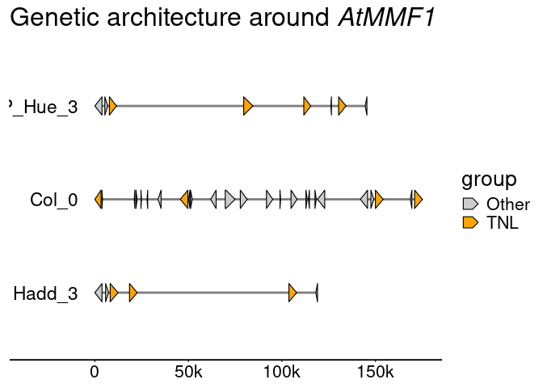
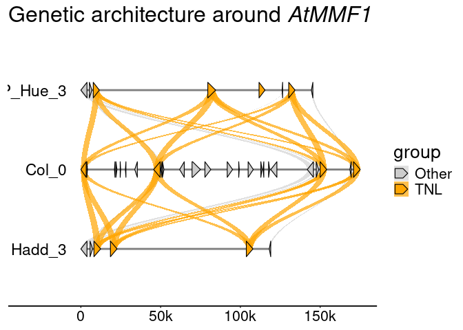

Comparative Genomics MMF1
================
Niklas Schandry
May 2026

# About

This file documents the analysis of syntenic relationships of the NLRs
around MMF1 (AT3G44630) between Col-0, IP-Hue-3 and Hadd-3. Genomes were
assembled using `hifiasm --ont`, and annotated using
<https://github.com/nschan/nf-annnotate>. This annotation pipeline also
produces NLR classification (`r_genes/find`), which have been stored in
`annotations/nlrs.rds`.

Functions in `functions/` were created as part of this project, to
improve downstream handling of genespace outputs.

# Session setup

``` r
library(tidyverse)
library(magrittr)
library(Biostrings)
library(GENESPACE)
library(future)
library(future.apply)
library(khroma)
library(gggenomes)
source("functions/genespace_2_gggenomes.R")
source("functions/themes_gggenespace.R")
source("functions/subset_pdat.R")
group_colors <- c("Other" = "grey80", "TNL" = "orange")
theme_set(theme_bw(base_size = 12))
theme_update(strip.background = element_rect(fill = "white"))
```

# Genespace

After input file preparation (`.bed` and `.pep` files according to
`GENESPACE` documentation), `GENESPACE` runs. Please note that `DIAMOND`
and `mcscanx` need to be correctly installed and / or paths below need
to be changed.

``` r
# Define accessions
accessions <- c("IP_Hue_3", "Col_0", "Hadd_3")

# Define paths
genespace_work <- "genespace"
mcscan_path <- "/opt/MCScanX/"
of_path <- "/opt/OrthoFinder/orthofinder"
diamond_path <- "/opt/OrthoFinder/bin/diamond"

# Initialize genespace
gs_acc <- init_genespace(
  genomeIDs = accessions,
  wd = genespace_work,
  path2mcscanx = mcscan_path,
  path2orthofinder = of_path,
  path2diamond = diamond_path,
  diamondUltraSens = FALSE,
  nCores = 32
)
```

    ## Checking Working Directory ... PASS: `genespace`
    ## Checking user-defined parameters ...
    ##  Genome IDs & ploidy ... 
    ##      IP_Hue_3: 1
    ##      Col_0   : 1
    ##      Hadd_3  : 1
    ##  Outgroup ... NONE
    ##  n. parallel processes ... 32
    ##  collinear block size ... 5
    ##  collinear block search radius ... 25
    ##  n gaps in collinear block ... 5
    ##  synteny buffer size... 100
    ##  only orthogroups hits as anchors ... TRUE
    ##  n secondary hits ... 0
    ## Checking annotation files (.bed and peptide .fa):
    ##  IP_Hue_3: 26239 / 26239 geneIDs exactly match (PASS)
    ##  Col_0   : 26936 / 26936 geneIDs exactly match (PASS)
    ##  Hadd_3  : 26279 / 26279 geneIDs exactly match (PASS)
    ## Checking dependencies ...
    ##  Found valid path to OrthoFinder v2.55: `/opt/OrthoFinder/orthofinder`
    ##  Found valid path to DIAMOND2 v2.013: `/opt/OrthoFinder/bin/diamond`
    ##  Found valid MCScanX_h executable: `/opt/MCScanX//MCScanX_h`

``` r
# Run genespace
gs_acc_out <- run_genespace(gs_acc)
```

    ## 
    ## ############################
    ## 1. Running orthofinder (or parsing existing results)
    ##  Checking for existing orthofinder results ...
    ## [1] FALSE
    ##  ... found existing run, not re-running orthofinder
    ## 
    ## ############################
    ## 2. Annotated/concatenated bed file exists
    ## 
    ## ############################
    ## 3. Annotated/blast files exists
    ## 
    ## ############################
    ## 5. Building synteny-constrained orthogroups ...
    ##  Done!
    ## 
    ## ############################
    ## 6. Integrating syntenic positions across genomes ...
    ##  ##############
    ##  Generating syntenic dotplots ... Done!
    ##  ##############
    ##  Interpolating syntenic positions of genes ... 
    ##  IP_Hue_3:  (0 / 1 / 2 / >2 syntenic positions)
    ##      Col_0   :   181 / 26309 /    31 /     0
    ##      Hadd_3  :    71 / 25626 /     1 /     0
    ##      IP_Hue_3:     0 / 26237 /     0 /     0
    ##  Col_0:  (0 / 1 / 2 / >2 syntenic positions)
    ##      Col_0   :     0 / 26936 /     0 /     0
    ##      Hadd_3  :    66 / 25603 /    20 /     9
    ##      IP_Hue_3:    46 / 25589 /    21 /     0
    ##  Hadd_3:  (0 / 1 / 2 / >2 syntenic positions)
    ##      Col_0   :   173 / 26328 /    20 /     0
    ##      Hadd_3  :     2 / 26247 /     0 /     0
    ##      IP_Hue_3:    39 / 25617 /     0 /     0
    ##  Done!
    ## 
    ## ############################
    ## 7. Final block coordinate calculation and riparian plotting ...
    ##  ##############
    ##  Calculating syntenic blocks by reference chromosomes ... 
    ##      n regions (aggregated by 25 gene radius): 138
    ##      n blocks (collinear sets of > 5 genes): 166
    ##  ##############
    ##  Building ref.-phased blks and riparian plots for haploid genomes:

    ##      IP_Hue_3: 89 phased blocks

    ##      Col_0   : 92 phased blocks

    ##      Hadd_3  : 85 phased blocks

    ##  Done!
    ## 
    ## ############################
    ## 8. Constructing syntenic pan-gene sets ...
    ##  IP_Hue_3: n pos. = 28109, synOgs = 78889, array mem. = 579, NS orthos 4684
    ##  Col_0   : n pos. = 28112, synOgs = 78841, array mem. = 641, NS orthos 4544
    ##  Hadd_3  : n pos. = 28111, synOgs = 78886, array mem. = 584, NS orthos 4795
    ## 
    ## ############################
    ## GENESPACE run complete!  All results are stored in genespace in the
    ## following subdirectories:
    ##  syntenic block dotplots: /dotplots (...synHits.pdf)
    ##  annotated blast files  : /syntenicHits
    ##  annotated/combined bed : /results/combBed.txt
    ##  syntenic block coords. : /results/blkCoords.txt
    ##  syn. blk. by ref genome: /riparian/refPhasedBlkCoords.txt
    ##  pan-genome annotations : /pangenes (...pangenes.txt.gz)
    ##  riparian plots         : /riparian
    ##  genespace param. list  : /results/gsParams.rda
    ## ############################
    ## **NOTE** the genespace parameter object is returned or can be loaded
    ##         into R via `load('genespace/results/gsParams.rda', verbose =
    ##         TRUE)`. Then you can customize your riparian plots by calling
    ##         `plot_riparian(gsParam = gsParam, ...)`. The source data and
    ##         ggplot2 objects are also stored in the /riparian directory and
    ##         can also be accessed by `load(...)`.
    ## **NOTE** To query genespace results by position or gene, use
    ##         `query_genespace(...)`. See specifications in ?query_genespace
    ##         for details.
    ## ############################

``` r
gs_acc_out |> write_rds("genespace/genespace_out.rds")
```

# Formatting

``` r
# Read in the files
gs_acc_out <- read_rds("genespace/genespace_out.rds")
annotations <- read_rds("annotations/annotations.rds")
gene_info <- read_rds("annotations/gene_info.rds")
nlrs <- read_rds("annotations/nlrs.rds")
```

Locate MMF1 in Col-0 annotations:

``` r
gene_info |> filter(str_detect(info, "AT3G44630"))
```

    ## # A tibble: 4 × 5
    ##   bin_id   seq_id feat_id                      type  info                       
    ##   <chr>    <chr>  <chr>                        <chr> <chr>                      
    ## 1 IP_Hue_3 Chr3   IP_Hue_3_evm.TU.Chr3.3209    gene  "ID=evm.TU.Chr3.3209;Name=…
    ## 2 IP_Hue_3 Chr3   IP_Hue_3_evm.model.Chr3.3209 mRNA  "ID=evm.model.Chr3.3209;Pa…
    ## 3 Col_0    Chr3   Col_0_evm.TU.Chr3.3339       gene  "ID=evm.TU.Chr3_RagTag.333…
    ## 4 Col_0    Chr3   Col_0_evm.model.Chr3.3339    mRNA  "ID=evm.model.Chr3_RagTag.…

``` r
# Chr3.3339
```

## ROI from genespace

``` r
col_0_mmf1_flank_bed <- annotations |>
  filter(bin_id == "Col-0") |>
  filter(str_detect(feat_id, "Chr3.3339")) |>
  slice_head(n = 1) %$%
  data.frame(
    genome = bin_id |> str_replace("-", "_"),
    chr = seq_id,
    start = start - 5000,
    end = end + 30000
  )

plotdat <- gs_to_gggenomes(
  gs_acc_out,
  bed = col_0_mmf1_flank_bed,
  accessions,
  pad = 0,
  annotations = annotations |>
    filter(type == "mRNA") |>
    dplyr::select(
      "feat_id",
      "seq_id",
      "start",
      "end" ,
      "strand",
      "bin_id",
      "type",
      "introns"
    ) |>
    mutate(
      bin_id = bin_id |> str_replace_all("-", "_"),
      seq_id = glue::glue("{bin_id}_{seq_id}"),
      feat_id = glue::glue("{bin_id}_{feat_id}"),
      name = NA
    )
)
```

    ## # Obtained pangenes in 0.72 seconds

    ## # Obtaining syntenic relationships

    ## # Obtained syntenic relationships in 8.12 seconds

    ## # Constructed features data in 0.02 seconds

    ## # Constructed syntenic genes in 0.03 seconds

    ## # Subsetting annotations

    ## # Finished subsetting annotations in 0.48 seconds

    ## # Creating sequence table

    ## # Finished creating sequences in 0.02 seconds

    ## # Creating ranges

    ## # Finished creating ranges in 0.02 seconds

    ## # Collecting synteny for ranges

    ## # Updated synteny in 5.96 seconds

    ## # Converting synteny to links

    ## # Converted synteny to links in 0.37 seconds

    ## # Finished. (Total time: 15.75 seconds)

Add info to gene table.

``` r
plotdat$genes <- plotdat$genes |>
  dplyr::select(seq_id, start, end, feat_id, bin_id, strand, introns, og) %>%
  mutate(gene_id = str_extract(feat_id, "Chr[0-5].*"))  |>
  left_join(
    nlrs |>  mutate(gene_id = str_extract(ID, "Chr[0-5].*")) |> dplyr::select(gene_id, Type, bin_id),
    by = c("gene_id", "bin_id")
  ) %>%
  mutate(
    group = case_when(!is.na(Type) ~ Type, TRUE ~ "Other") %>%
      fct_relevel("Other"),
    type = "CDS" # for gggenomes
  )
```

Add info to links.

``` r
plotdat$links <- plotdat$links %>%
  left_join(plotdat$genes %>%
              dplyr::select(seq_id, start, end, og, group)) %>%
  left_join(
    plotdat$genes %>% dplyr::select(
      seq_id2 = seq_id,
      start2 = start,
      end2 = end,
      group2 = group
    )
  ) %>%
  mutate(group = case_when(!is.na(group) ~ group, !is.na(group2) ~ group2, TRUE ~ group)) %>%
  dplyr::select(-group2)
```

    ## Joining with `by = join_by(seq_id, start, end)`
    ## Joining with `by = join_by(seq_id2, start2, end2)`

Arrange sequences in order for plotting.

``` r
plotdat$seqs <- plotdat$seqs |>
  mutate(genome = bin_id  |>
           factor(levels = accessions, ordered = T)) |>
  dplyr::arrange(genome) |>
  mutate(seq_id = factor(seq_id, ordered = T)) |>
  dplyr::select(-genome) 
```

Compute nicer polygons for drawing syntenic relationships.

``` r
plotdat$polygons <- compute_polygons(plotdat, c("IP_Hue_3_Chr3","Col_0_Chr3","Hadd_3_Chr3"))
```

# Plot

## Without syntenic relationships

``` r
gggenomes::gggenomes(genes = plotdat$genes,
                     seqs = plotdat$seqs,
                     links = plotdat$links) +
  geom_seq(color = "grey50", linewidth = 1) +
  geom_gene(
    aes(fill = group),
    color = "black",
    size = 6,
    intron_types = NA
  ) +
  geom_bin_label(color = "black", size = 6) +
  scale_fill_manual(
    values = group_colors,
    breaks = levels(plotdat$genes$group),
    limits = levels(plotdat$genes$group)
  ) +
  scale_color_manual(
    values = group_colors,
    breaks = levels(plotdat$genes$group),
    limits = levels(plotdat$genes$group)
  ) +
  ggtitle(expression(paste(
    'Genetic architecture around ', italic('AtMMF1')
  ))) +
  theme_ggg_light(base_size = 20) +
  theme(text = element_text(size = 20), axis.text.x = element_text(size = 16))
```

    ## Warning: The `size` argument of `element_line()` is deprecated as of ggplot2 3.4.0.
    ## ℹ Please use the `linewidth` argument instead.
    ## This warning is displayed once every 8 hours.
    ## Call `lifecycle::last_lifecycle_warnings()` to see where this warning was
    ## generated.

<!-- -->

## With syntenic relationships

``` r
gggenomes::gggenomes(genes = plotdat$genes,
                     seqs = plotdat$seqs,
                     links = plotdat$links) +
  geom_polygon(
    data = plotdat$polygons %>% filter(direct, group == "Other"),
    aes(
      x = x,
      y = y,
      fill = group,
      group = link
    ),
    alpha = 0.6
  ) +
  geom_polygon(
    data = plotdat$polygons %>% filter(direct, group != "Other"),
    aes(
      x = x,
      y = y,
      fill = group,
      group = link
    ),
    alpha = 0.7
  ) +
  geom_seq(color = "grey50", linewidth = 1) +
  geom_gene(
    aes(fill = group),
    color = "black",
    size = 6,
    intron_types = NA
  ) +
  geom_bin_label(color = "black", size = 6) +
  scale_fill_manual(
    values = group_colors,
    breaks = levels(plotdat$genes$group),
    limits = levels(plotdat$genes$group)
  ) +
  scale_color_manual(
    values = group_colors,
    breaks = levels(plotdat$genes$group),
    limits = levels(plotdat$genes$group)
  ) +
  ggtitle(expression(paste(
    'Genetic architecture around ', italic('AtMMF1')
  ))) +
  theme_ggg_light(base_size = 20) +
  theme(text = element_text(size = 20), axis.text.x = element_text(size = 16))
```

<!-- -->

# Sessioninfo

``` r
sessionInfo()
```

    ## R version 4.5.3 (2026-03-11)
    ## Platform: x86_64-pc-linux-gnu
    ## Running under: Debian GNU/Linux 12 (bookworm)
    ## 
    ## Matrix products: default
    ## BLAS:   /usr/lib/x86_64-linux-gnu/openblas-pthread/libblas.so.3 
    ## LAPACK: /usr/lib/x86_64-linux-gnu/openblas-pthread/libopenblasp-r0.3.21.so;  LAPACK version 3.11.0
    ## 
    ## locale:
    ##  [1] LC_CTYPE=C.UTF-8       LC_NUMERIC=C           LC_TIME=C.UTF-8       
    ##  [4] LC_COLLATE=C.UTF-8     LC_MONETARY=C.UTF-8    LC_MESSAGES=C.UTF-8   
    ##  [7] LC_PAPER=C.UTF-8       LC_NAME=C              LC_ADDRESS=C          
    ## [10] LC_TELEPHONE=C         LC_MEASUREMENT=C.UTF-8 LC_IDENTIFICATION=C   
    ## 
    ## time zone: Etc/UTC
    ## tzcode source: system (glibc)
    ## 
    ## attached base packages:
    ## [1] stats4    stats     graphics  grDevices datasets  utils     methods  
    ## [8] base     
    ## 
    ## other attached packages:
    ##  [1] gggenomes_1.1.3     khroma_1.17.0       future.apply_1.20.2
    ##  [4] future_1.70.0       GENESPACE_1.3.1     Biostrings_2.78.0  
    ##  [7] Seqinfo_1.0.0       XVector_0.50.0      IRanges_2.44.0     
    ## [10] S4Vectors_0.48.1    BiocGenerics_0.56.0 generics_0.1.4     
    ## [13] magrittr_2.0.3      lubridate_1.9.4     forcats_1.0.0      
    ## [16] stringr_1.5.2       dplyr_1.1.4         purrr_1.1.0        
    ## [19] readr_2.1.5         tidyr_1.3.1         tibble_3.3.0       
    ## [22] ggplot2_3.5.2       tidyverse_2.0.0    
    ## 
    ## loaded via a namespace (and not attached):
    ##  [1] gtable_0.3.6        xfun_0.53           tzdb_0.5.0         
    ##  [4] vctrs_0.6.5         tools_4.5.3         parallel_4.5.3     
    ##  [7] pkgconfig_2.0.3     R.oo_1.27.1         data.table_1.17.8  
    ## [10] RColorBrewer_1.1-3  lifecycle_1.0.4     compiler_4.5.3     
    ## [13] farver_2.1.2        codetools_0.2-20    htmltools_0.5.8.1  
    ## [16] yaml_2.3.10         pillar_1.11.0       crayon_1.5.3       
    ## [19] R.utils_2.13.0      dbscan_1.2.4        parallelly_1.47.0  
    ## [22] tidyselect_1.2.1    digest_0.6.37       stringi_1.8.7      
    ## [25] listenv_0.10.1      labeling_0.4.3      fastmap_1.2.0      
    ## [28] grid_4.5.3          colorspace_2.1-2    cli_3.6.5          
    ## [31] utf8_1.2.6          withr_3.0.2         scales_1.4.0       
    ## [34] timechange_0.3.0    rmarkdown_2.29      globals_0.19.1     
    ## [37] igraph_2.3.2        R.methodsS3_1.8.2   hms_1.1.3          
    ## [40] evaluate_1.0.5      knitr_1.50          dtplyr_1.3.1       
    ## [43] rlang_1.1.6         Rcpp_1.1.1-1.1      glue_1.8.0         
    ## [46] BiocManager_1.30.27 renv_1.1.5          jsonlite_2.0.0     
    ## [49] rstudioapi_0.17.1   R6_2.6.1
